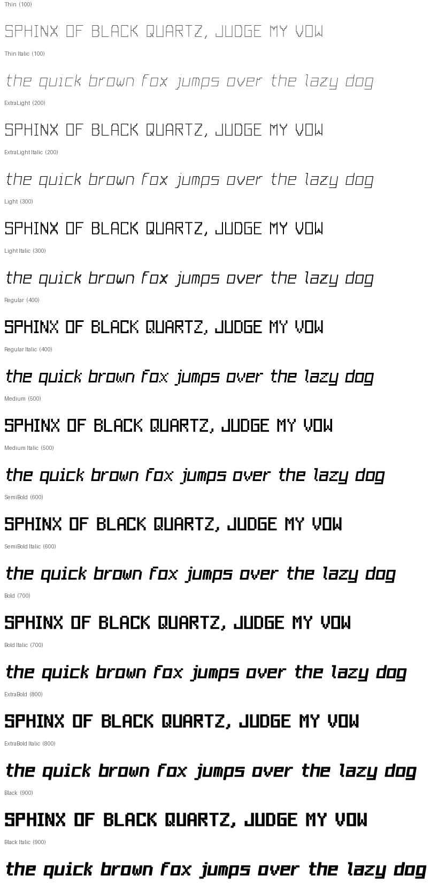

# PixelForge

An original pixel-grid type family: 9 weights × upright and pixel-step italic, built procedurally from hand-drawn pixel maps.



> **Status:** 1.000, prepared locally. It is not yet published to GitHub, and it has no release or Pages site yet.

## Styles and formats
9 weights × 2 slopes = **18 static styles**, each as **TTF** (TrueType outlines), **OTF** (CFF outlines), and **WOFF2**, for 54 files. There are also **2 variable fonts** (`wght` 100–900: `PixelForge[wght]` and `PixelForge-Italic[wght]`, TTF + WOFF2).

| Weight | 100 | 200 | 300 | 400 | 500 | 600 | 700 | 800 | 900 |
|---|---|---|---|---|---|---|---|---|---|
| Name | Thin | ExtraLight | Light | Regular | Medium | SemiBold | Bold | ExtraBold | Black |

Each has an Italic. Naming follows the RIBBI model: Regular, Italic, Bold, and Bold Italic share family `PixelForge`. Other weights use family `PixelForge <Weight>` (name ID 1/2) plus typographic names `PixelForge` / `<Style>` (ID 16/17).

**Variable fonts:** Built from all 9 masters per slope, with overlaps preserved and OVERLAP_SIMPLE flagged. Intermediate weights interpolate pixel ink width, so they are smooth but off-grid. Use the statics where exact pixel edges matter.

## Design
PixelForge is drawn on a **5-column, 8-row cap grid** (x-height 6 rows, 2-row descenders, 2 rows for accents). That gives a 10-row body, and each pixel is a 100-unit cell. I tested smaller grids (5×7) and larger ones (8×12). 5×7 can't give a distinct x-height plus descenders, and 8×12 loses the chunky arcade read at UI sizes. 5×8 is the smallest grid where `a e s` get a real two-storey structure and `g j p q y` real descenders.

* **Regular** is the true bitmap: pixel ink = cell, so every edge sits on the 100-unit grid (tested).
* **Thin → Light** draw pixels as small squares joined by bridges, and diagonals become explicit stair steps. This is a skeleton of the bitmap, not a shrunken copy.
* **Medium → Black** grow stems horizontally (up to 176 units) more than bars vertically (up to 130). Growth into any one-pixel counter is capped at 18/15 units, so `m`, `e`, `B`, `8`, `#` stay open at Black. The advance grows with the stem so spacing keeps the rhythm.
* **Italics** shift each pixel row 16 units to the right: a drawn stepped slant with horizontal rows, at ≈9.1°.
* **Kerning** is pixel kerning. A pair tightens by exactly one pixel when every shared row keeps at least two pixels of paper between the glyphs.

## Where it shines
PixelForge is a **proportional** pixel family. Letters keep bitmap logic, but `i`, `l`, `I` are narrow and `m`, `w`, `©` wide, so text sets like a real UI font and not like a terminal dump. Pixel kerning tightens gaps like `To`, `LT`, `r.` by exactly one pixel.

| Use | Suggested styles |
|---|---|
| Title screens, logos | Black, ExtraBold, Black Italic |
| HUD / menus at 12–24 px | Regular, Medium (Regular is grid-exact at multiples of 10 px/em) |
| Large light display | Thin, ExtraLight (stair-stepped skeleton) |

**Crisp-pixel tip:** at `font-size: 10px × n` (with UPM 1000 and a 100-unit pixel cell), Regular's edges land on device pixels. Set `-webkit-font-smoothing: none` where available for a hard bitmap look.

## OpenType features
`kern` (pixel kerning), `zero` (slashed zero), `ss01` (dotted zero).

## Coverage
375 glyphs, 372 encoded code points (full manifest: [docs/COVERAGE.md](docs/COVERAGE.md), [docs/coverage.json](docs/coverage.json)).

| Block | Code points |
|---|---|
| Basic Latin | 95 |
| Latin-1 Supplement | 93 |
| Latin Extended-A | 2 |
| General Punctuation | 10 |
| Currency Symbols | 1 |
| Arrows | 4 |
| Box Drawing | 128 |
| Block Elements | 32 |
| Private Use (Powerline) | 7 |

Not yet covered: ¼ ½ ¾ (U+00BC–00BE), Latin Extended-A beyond ı/Ÿ, Greek, Cyrillic, and Nerd Font icons.

## Install

### Linux (per user)
```sh
mkdir -p ~/.local/share/fonts/PixelForge
cp fonts/otf/*.otf fonts/variable/*.ttf ~/.local/share/fonts/PixelForge/   # or unzip the release archive
fc-cache -f ~/.local/share/fonts
fc-list | grep -i pixelforge
```
Install either the static OTFs **or** the TTFs, not both, to avoid duplicate menu entries. The variable TTFs can sit alongside the static fonts.

### Nix / NixOS
```nix
# flake input:  pixelforge.url = "github:r3dg0d/pixelforge-font";
fonts.packages = [ inputs.pixelforge.packages.${pkgs.system}.default ];
```
Or `nix build .#pixelforge` in this repo (it builds from source and runs the test suite).

### Arch Linux
`packaging/PKGBUILD` installs a release archive. Fill in the checksum once a release exists.

### Web
```html
<link rel="stylesheet" href="css/pixelforge.css">            <!-- static, Latin + terminal subsets -->
<link rel="stylesheet" href="css/pixelforge-variable.css">   <!-- family "PixelForge Variable" -->
```
```css
body { font-family: "PixelForge", monospace; font-feature-settings: "zero" 0; }
```
Terminal and editor snippets: [docs/terminals.md](docs/terminals.md).

## Build from source
```sh
nix develop          # or nix-shell
make fonts           # deterministic: sources/ufo → fonts/{ttf,otf,woff2,variable} + SHA256SUMS
make test            # pytest suite
python3 tools/webfonts.py && python3 tools/qa.py all   # subsets, CSS, specimens, coverage, regression
make fontbakery      # FontBakery universal profile → docs/fontbakery-*.md
make site            # showcase site → site/dist
```
Source of truth: `sources/pixelmaps.txt` and `tools/engine.py` (pixel map → weighted pixel rectangles + bridges + stepped diagonals → pathops union). The UFO masters and designspaces in `sources/` are generated from those and kept editable.

## Quality assurance
See [docs/QA.md](docs/QA.md) for real results from the latest local build: pytest, FontBakery, OTS, rasterisation, shaping, and visual regression.

## License
* Fonts and font sources: **SIL Open Font License 1.1** with Reserved Font Name **“PixelForge”**. See [OFL.txt](OFL.txt).
* Build tooling: **MIT**. See [LICENSE-TOOLS](LICENSE-TOOLS).

Copyright 2026 Vincent Patrick Chambers.
